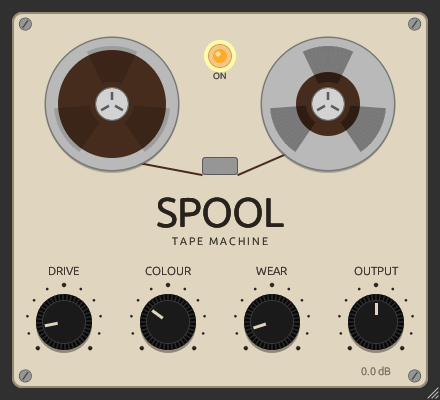

# Spool

[](https://github.com/accraze/spool/actions/workflows/ci.yml)

A tape machine plugin (CLAP / VST3) built with [nih-plug](https://github.com/robbert-vdh/nih-plug).
Dial up the drive and add some wear and colour to taste. Keep it subtle for a touch of glue on
your master, or push it for all-out lofi wonkiness.

<p align="center"></p>

| Control | Range | What it does |
|---------|-------|--------------|
| Drive   | 0–24 dB | Tape saturation. Highs are pre-emphasised so they saturate first. Level-compensated: quiet parts stay put, peaks get squashed |
| Colour  | 0–100% | Head bump (up to +4 dB at 90 Hz) and top-end roll-off (20 kHz → 5 kHz) |
| Wear    | 0–100% | Wow and flutter, hiss, dropouts, and a further loss of highs. Low settings are near-inaudible; the top end gets wonky |
| Output  | −12 to +12 dB | Make-up gain |
| Lamp    | Bypass (lit when the tape is running) |

Knobs: drag or scroll to turn, hold Shift for fine control, double-click to reset.
Drag the bottom-right corner to resize the window. Spool reports 7 ms of latency for its wow and
flutter delay line.

## Build

Needs a recent Rust from [rustup](https://rustup.rs) (distro packages are usually too old).
The GUI (egui) also needs X11/GL headers:

```sh
sudo apt install libx11-xcb-dev libxcb1-dev libxcb-dri2-0-dev libxcb-icccm4-dev libxcursor-dev libxkbcommon-dev libxcb-shape0-dev libxcb-xfixes0-dev libgl-dev
```

```sh
cargo xtask bundle spool --release
cargo test --lib
```

Bundles land in `target/bundled/`.

## Install (Linux)

Grab `spool-<version>-linux.zip` from [Releases](https://github.com/accraze/spool/releases) and unzip it, or build it yourself. Then:

```sh
cp target/bundled/Spool.clap ~/.clap/
cp -r target/bundled/Spool.vst3 ~/.vst3/   # optional
```

Then rescan plug-ins in your DAW.

## Releasing

Changes are listed in [CHANGELOG.md](CHANGELOG.md). See [docs/RELEASING.md](docs/RELEASING.md) for the process. In short: bump the version, push an annotated `v*` tag, and CI publishes the release.

## License

Spool is licensed under the [GNU General Public License v3.0 or later](LICENSE).
nih-plug itself is ISC licensed, but its VST3 bindings are GPLv3, so VST3 builds must be GPL anyway.
